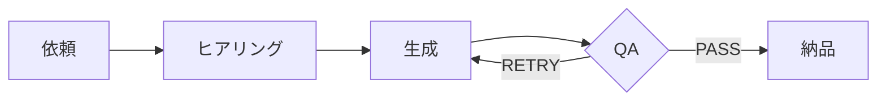

# Vault リッチ表示デザインガイド

Obsidian vault（`{{VAULT_PATH}}`）に**人が読むページ**を書くときの共通ルール。
スキル一覧・マニュアル・ルール集・パスワード台帳・メルマガ保管庫など、長文原稿を機械的に保存するフォルダ（書籍原稿・議事録の生ログなど）**以外**の全ページに適用する。

狙いは一つ。**開いた瞬間に「これは何・どう使う・どこにある」が色と形で分かる**こと。プレーンな見出し＋長文段落＋巨大テーブルの羅列は禁止。

## 0. 前提（Vaultに入れてある部品）

| 部品 | 場所 | 役割 |
|---|---|---|
| CSSスニペット `rich-vault` | `<vault>/.obsidian/snippets/rich-vault.css`（原本 `~/.claude/skills/obsidian/assets/rich-vault.css`） | カスタムcallout10種・見出し帯・テーブル装飾・タグ色・kbd/progress |
| `appearance.json` | `<vault>/.obsidian/appearance.json` の `enabledCssSnippets: ["rich-vault"]` | スニペット有効化（消えていたら書き戻す） |
| Bases（コアプラグイン・有効） | `スキル一覧/スキルDB.base` など | frontmatterをデータベース表示。一覧ページに `![[...base]]` で埋め込む |
| テンプレート | `~/.claude/skills/obsidian/templates/*.md` | ページ種別ごとの雛形。コピーして埋める |

スニペットが無効でも壊れないように、**色付きピルはインラインstyle**で書く（下記）。calloutの独自タイプはスニペットなしでも標準calloutとして表示される。

## 1. 使う表現部品（この10個を組み合わせる）

### 1-1. frontmatter（全ページ必須）

```yaml
---
type: skill | manual | index | secret | style | newsletter | note
title: 表示名
summary: 一行要約（40〜60字）
category: カテゴリ名（スキル・マニュアル）
status: active | legacy | external | draft
updated: YYYY-MM-DD
tags: [skill, cat/xxx, status/active]
cssclasses: [rich-doc, skill-page]
---
```

- `cssclasses` は `rich-doc`（共通）＋ページ種別（`skill-page` / `codex-page` / `manual-page` / `secret-page` / `style-page` / `mail-page` / `index-page`）の2つ。見出し帯の色が種別で変わる
- `tags` の `cat/xxx` はスニペットで色分けされる。一覧は §4
- Basesはこのfrontmatterを読むので、`summary` `category` `status` `updated` はスキルページで**必ず**埋める
- 例外: 雛形ファイル（`_テンプレート.md` など、コピーされて各回の実ファイルになるもの）には `updated` を入れない。固定日付がコピー先に残って誤情報になるため

### 1-2. 見出し直下の「顔」callout

H1の直後に必ず1つ、そのページの要約calloutを置く。種別で使い分ける。

```markdown
> [!skill] ひとことで
> WordPressにニュース・実績の下書きを作る統合スキル。アイキャッチも自動生成。
```

| 種別 | callout | 色 |
|---|---|---|
| スキル | `[!skill]` | 青 |
| マニュアル | `[!abstract] これは何` | 標準（青緑） |
| パスワード・秘匿 | `[!secret]` | 赤 |
| 文体・ルール | `[!rule]` | アンバー |
| 一覧・INDEX | `[!info]` | 青 |

### 1-3. ピル（色付きラベル）

状態・種別・数を一目で示す。**インラインstyleで書く**（スニペット不要で動く）。

```html
<span style="display:inline-block;padding:1px 9px;border-radius:999px;background:#2563eb1f;color:#2563eb;font-weight:600;font-size:.85em;white-space:nowrap">ラベル</span>
```

色は背景に `1f`（透明度）を付けるだけ。使う色は8つに固定する。

| 用途 | 色コード | 例 |
|---|---|---|
| 情報・スキル・既定 | `#2563eb` 青 | カテゴリ、Claude Code |
| 正常・有効・完了 | `#16a34a` 緑 | active、認証あり、PASS |
| 注意・レガシー・共通PW | `#d97706` アンバー | legacy、共通パスワード |
| 危険・秘匿・禁止 | `#dc2626` 赤 | 個別PW、削除禁止 |
| エージェント・ナレッジ | `#7c3aed` 紫 | サブエージェント◯体 |
| Codex・外部 | `#0d9488` ティール | Codexブリッジ |
| デザイン・画像 | `#db2777` ピンク | 画像生成 |
| 中立・その他 | `#6b7280` グレー | 認証なし、未分類 |

ピルの並びはH1直下のcalloutのすぐ下に1行で置く（3〜6個まで）。

### 1-4. カスタムcallout（スニペットで定義済み）

| 記法 | 使いどころ |
|---|---|
| `> [!skill]` | スキルの要約 |
| `> [!trigger]-` | 発動ワード一覧（折りたたみ既定） |
| `> [!flow]` | 処理の流れ（中に番号リスト or mermaid） |
| `> [!path]` | ファイルの場所・パス一覧 |
| `> [!secret]` | パスワード・鍵・取り扱い注意 |
| `> [!agent]` | 関連エージェントと役割 |
| `> [!rule]` | 恒久ルール・禁止事項 |
| `> [!step]` | マニュアルの各手順ブロック |
| `> [!result]` | 成果物・出力先 |
| `> [!kb]` | 学び・ハマりどころ |

標準calloutも併用する: `[!tip]` `[!warning]` `[!danger]` `[!example]` `[!question]` `[!todo]` `[!success]` `[!failure]` `[!quote]`。
長いものは `[!trigger]-` のように `-` を付けて**折りたたみ既定**にする（発動ワード・凡例・変更履歴・生ログ）。

### 1-5. テーブル

- 列は**最大4列**。5列以上になるなら分割するか、詳細列をピルに置き換える
- 1セル**60字以内**。長文はテーブルに入れず、見出し＋段落へ逃がす
- 1列目は名前（自動で太字・折り返しなし）。パスワード・パス・コマンドは `code` で囲む
- 状態列はピル、URLはそのまま貼る（Obsidianが自動リンク）

### 1-6. 手順（マニュアル）

```markdown
## Step 1 — 用語を押さえる
> [!step] やること
> 1. ...
> 2. ...

> [!warning] つまずきやすい点
> ...
```

キー操作は `<kbd>Cmd</kbd> + <kbd>Space</kbd>`。所要時間・難易度はfrontmatterとピルで示す。最後に `- [ ]` のチェックリストを置く。

### 1-7. mermaid（流れ・分岐・構成）

3ステップ以上の処理フローや役割分担は文章でなく図にする。



### 1-8. 進捗・数値

`<progress value="3" max="10"></progress> 3/10` のようにバーで示す。件数は `**92**件 のように太字。

### 1-9. ハイライトと強調

- 恒久ルール・禁止事項は `==黄色ハイライト==`
- 「絶対にやらない」は `<span style="color:#dc2626;font-weight:700">赤字太字</span>`
- 絵文字をアイコン代わりに並べない（見出し先頭の絵文字も不要。色と形で区別する）

### 1-10. Bases（データベース表示）

frontmatterを持つページ群には `.base` を1つ作り、INDEXの先頭に `![[フォルダ/名前.base]]` で埋め込む。フィルタは `file.inFolder("フォルダ名")`。ビューは「一覧（table）」「カテゴリ別（groupBy）」「カード（cards）」の3つを基本にする。雛形は `templates/skill-db.base`（`file.inFolder(...)` のフォルダ名は自分のvaultに合わせて書き換える）。

実測でわかったこと:

- frontmatterの参照は `note.type` のように `note.` を付ける（`type == "skill"` は通らない）
- `columnSize` の合計は**本文幅（既定テーマで約700px）に収める**。超えるとセルが切れる。埋め込みを本文より広げるCSS（`width: calc(100% + Npx)`）は効かない
- 埋め込みが長くなるので、スニペットで `.index-page .bases-embed .bases-table-container { max-height: 340px; overflow: auto; }` を当てて高さを抑える
- 見出しへのジャンプリンクは `[[#カテゴリ名]]` と**素で書く**。`<span style=...>` で包むと編集モードで生の `[[#...]]` が見えてしまう。ピル装飾はスニペット側（`.index-page a.internal-link[href^="#"]` と `.cm-hmd-internal-link`）で当てる
- スニペットを直したら `obsidian snippet:disable name=rich-vault` → `snippet:enable` で再読込すると即反映される

## 2. ページ種別ごとの構成

### 2-1. スキル詳細ページ（スキル一覧フォルダ）

`templates/skill-page.md` を使う。構成は固定:

1. frontmatter（`type: skill`, `runtime: claude-code|codex`, `command`, `category`, `summary`, `trigger`, `agents`, `status`, `updated`, `tags`, `cssclasses`）
2. `# /コマンド名`
3. `> [!skill] ひとことで`（1〜2行）
4. ピル行: カテゴリ／status／Codexブリッジ有無／エージェント数／依存
5. `> [!trigger]- 発動ワード`（箇条書き）
6. `## 何ができる`（段落2〜4本。元の「概要」を人が読む文に）
7. `## 使い方`（コマンド例はコードブロック、入力項目はテーブル）
8. `## 処理の流れ`（`[!flow]` に番号リスト。5ステップ以上ならmermaid）
9. `## 出力・成果物`（`[!result]`）
10. `## ルール・注意`（`[!rule]` / `[!warning]`。恒久ルールは==ハイライト==）
11. `## 関連エージェント`（`[!agent]` にテーブル: 名前｜役割｜起動タイミング）
12. `## 場所`（`[!path]` に原本・ブリッジ・スクリプト・参照ファイル）
13. `## 変更履歴`（`[!info]-` 折りたたみ。日付付き箇条書き）

元ページの情報は**一切落とさない**。長い段落は見出しやcalloutに振り分けて読みやすくするだけで、削除はしない。

### 2-2. 一覧ページ（INDEX）

`templates/index-page.md`。

1. frontmatter（`type: index`）
2. `# タイトル` ＋ `> [!info]` に総数・保存場所・更新日
3. ピルでカテゴリのジャンプリンク（`[[#見出し]]`）
4. `![[スキルDB.base]]` 埋め込み
5. カテゴリごとに `## カテゴリ名` ＋ 3列テーブル `| スキル | ひとこと | 発動ワード例 |`
   - ひとことは**40字以内**。長い説明は詳細ページに任せる
   - リンクはフォルダ付きの完全パス `[[スキル一覧/wp|/wp]]`（別フォルダに同名ページがあっても衝突しないように）
6. 末尾に `## 保存場所とルール`（`[!path]` `[!rule]`）

### 2-3. マニュアル

`templates/manual.md`。frontmatter（`type: manual`, `対象`, `所要時間`, `難易度`, `前提`）→ `[!abstract] これは何` → ピル（対象／所要時間／難易度）→ `## 前提チェック`（`- [ ]`）→ `## Step N — 見出し`（`[!step]` ＋ `[!warning]`）→ `## トラブルシューティング`（`[!failure]` 症状 → `[!success]` 対処）→ `## 完了チェック`。

### 2-4. パスワード・秘匿台帳

`templates/secret-page.md`。`[!secret]` で取り扱い注意を先頭に。グループごとに `## 見出し` ＋ ピル（個別PW=赤／共通PW=アンバー／認証なし=グレー）＋ 4列テーブル（サイト｜URL｜パスワード｜メモ）。IDが共通なら表から外して上に1回書く。運用手順は `[!step]`、禁止は `[!danger]`。

### 2-5. ルール集（NG表現リスト・チェックリストなど、1行ずつ追記するページ）

**リスト本体は `- ` 箇条書きのまま**（`obsidian append` で1行足せる形を壊さない）。装飾は上部だけ: frontmatter＋`[!rule]` に使い方＋ピル。項目自体にピルや表は付けない。

### 2-6. メルマガ保管庫・ネタ帳・その他ノート

frontmatter＋顔callout＋ピルを付け、既存のテーブルは4列以内に整える。スキルが自動追記する箇所（`<!-- 新しい号は上の行に追記 -->` など）はマーカーごと残す。

## 3. 書き方の作法

- 日本語はAI臭を消す（テンプレ前置き・「〜していきましょう」禁止、同じ語尾3連続禁止、抽象形容詞で逃げない）。文体ルールのページをvaultに置いているなら、書く前にそれを読む
- 「概要」「使い方」「技術情報」のような無味乾燥な見出しは避け、「何ができる」「使い方」「場所」など読み手の問いに答える言葉にする
- 1画面（およそ40行）に最低1つは色のある要素（callout／ピル／ハイライト）が入るようにする
- 書き込みはCLIが第一手段だが、**コードブロックにバックスラッシュを含むページは直接ファイルに書く**（CLIの `content=` が `\n` を実改行に変えるため）。書いたら `obsidian file path="..."` で反映を確認する

## 4. カテゴリタグ一覧（スニペットで色付き）

| タグ | カテゴリ | タグ | カテゴリ |
|---|---|---|---|
| `cat/wordpress` | WordPress投稿 | `cat/lp` | LP制作 |
| `cat/document` | ドキュメント・資料作成 | `cat/web` | Webサイト機能・公開 |
| `cat/video` | 動画編集 | `cat/business` | 業務ツール |
| `cat/newsletter` | メルマガ | `cat/dev` | 開発・オーケストレーション |
| `cat/line` | LINE配信 | `cat/news` | ニュース・情報配信 |
| `cat/sns` | SNS投稿 | `cat/book` | 書籍執筆 |
| `cat/event` | イベント告知 | `cat/knowledge` | ナレッジ管理 |
| `cat/image` | 画像生成 | `status/active` | 稼働中 |
| `cat/external` | 外部スキル | `status/legacy` | 旧版 |
| `cat/design` | デザインシステム | `status/external` | サードパーティ |

新しいカテゴリが要るときは、スニペットの `a.tag[href="#cat/xxx"]` に1行足してから使う。上の一覧は初期セットなので、使わないカテゴリはそのまま放置してよい（CSSに残っていても害はない）。
