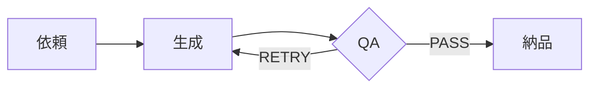

# /skill-name

> [!skill] ひとことで
> 何を・どうやって・何が出るか、を1〜2行で。

<span style="display:inline-block;padding:1px 9px;border-radius:999px;background:#2563eb1f;color:#2563eb;font-weight:600;font-size:.85em;white-space:nowrap">カテゴリ名</span> <span style="display:inline-block;padding:1px 9px;border-radius:999px;background:#16a34a1f;color:#16a34a;font-weight:600;font-size:.85em;white-space:nowrap">active</span> <span style="display:inline-block;padding:1px 9px;border-radius:999px;background:#0d94881f;color:#0d9488;font-weight:600;font-size:.85em;white-space:nowrap">Codexブリッジあり</span> <span style="display:inline-block;padding:1px 9px;border-radius:999px;background:#7c3aed1f;color:#7c3aed;font-weight:600;font-size:.85em;white-space:nowrap">エージェント2体</span>

> [!trigger]- 発動ワード
> - 「〜して」
> - 「〜作って」
> - `/skill-name`

## 何ができる

段落で2〜4本。元の「概要」を、読み手が「自分の仕事でどう使うか」を想像できる文にする。

## 使い方

```
/skill-name <引数>
```

| 入力 | 必須 | 説明 |
|---|---|---|
| 引数A | 必須 | ... |
| オプションB | 任意 | 既定値は ... |

## 処理の流れ

> [!flow] 5ステップ
> 1. ヒアリング
> 2. 生成
> 3. QA
> 4. 修正
> 5. 納品



## 出力・成果物

> [!result] 出てくるもの
> - `~/Desktop/xxx/` に ...

## ルール・注意

> [!rule] 恒久ルール
> - ==〜は必ず〜する==（YYYY-MM-DD）

> [!warning] ハマりどころ
> - ...

## 関連エージェント

> [!agent] 2体
> | エージェント | 役割 | 起動タイミング |
> |---|---|---|
> | agent-a | ... | STEP 2 |
> | agent-b | ... | 納品前 |

## 場所

> [!path] ファイル
> - 原本: `~/.claude/skills/skill-name/SKILL.md`
> - Codexブリッジ: `~/.codex/skills/skill-name/SKILL.md`
> - スクリプト: `scripts/xxx.py`
> - 参照: `references/xxx.md`

## 変更履歴

> [!info]- 履歴
> - YYYY-MM-DD: 作成
